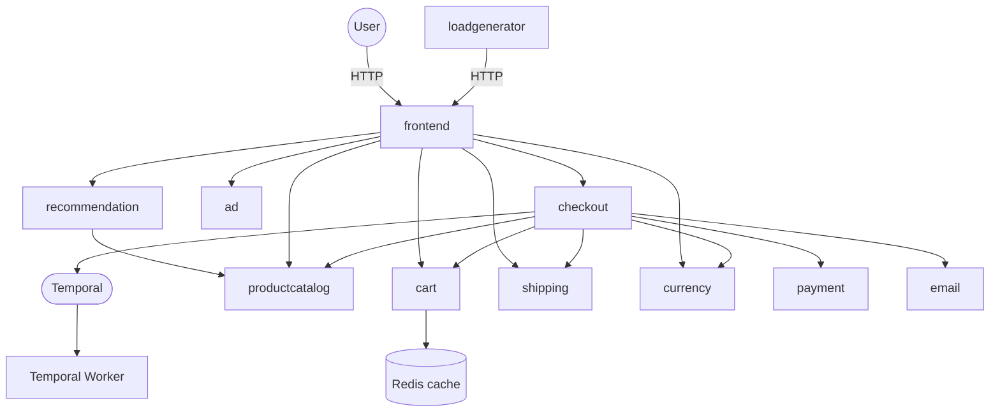

# Architecture diagram

## Diagram using `architecture-beta` Mermaid
architecture-beta
    %%group temporal(cloud)[Temporal]
    group boutique(server)[Boutique]

    service user(internet)[Users]

    service frontend(server)[Front End] in boutique
    service cart(server)[Cart] in boutique
    service cartdb(database)[Redis Cache] in boutique
    service checkout(server)[Checkout] in boutique
    service ads(server)[Ads] in boutique
    service recs(server)[Recommendation] in boutique
    service catalog(server)[Catalog] in boutique
    service ship(server)[Shipping] in boutique
    service currency(server)[Currency] in boutique
    service pay(server)[Payment] in boutique
    service email(server)[Email] in boutique
    %% service worker(server)[Temporal Workers] in boutique

    %%service server(server)[Temporal Server (SaaS)] in temporal

    user:B -- T:frontend

    frontend:R -- L:checkout
    frontend:B -- T:ads
    frontend:B -- T:recs
    frontend:B -- T:catalog
    frontend:B -- T:cart
    frontend:B -- T:ship
    frontend:B -- T:currency

    checkout:B -- T:catalog
    checkout:B -- T:cart
    checkout:B -- T:ship
    checkout:B -- T:currency
    checkout:R -- L:pay
    checkout:R -- L:email

    recs:R -- L:catalog

    cart:B -- T:cartdb

    align row frontend checkout pay

    align column pay email
    align column user frontend
    align row ads recs catalog cart ship currency email
    align column checkout currency
    align column cart cartdb

## Original

checkout:B -- T:ship
