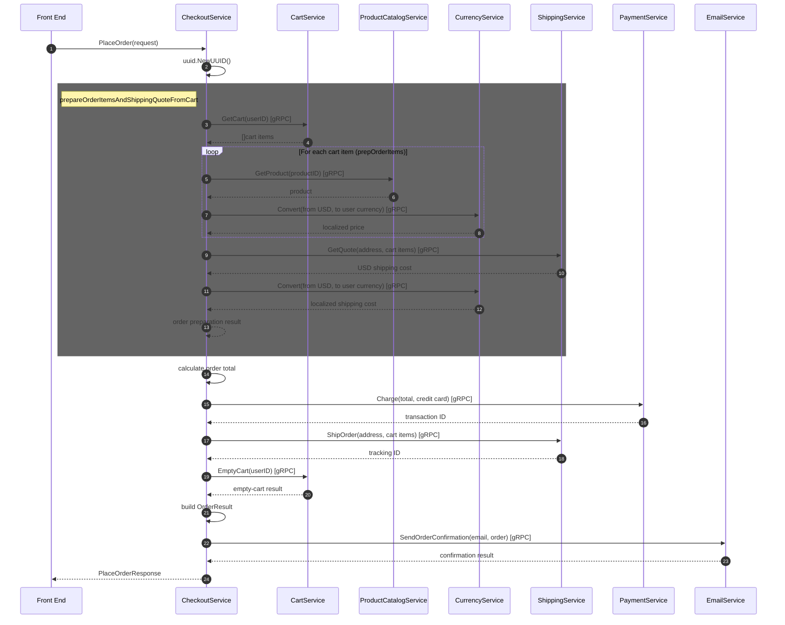
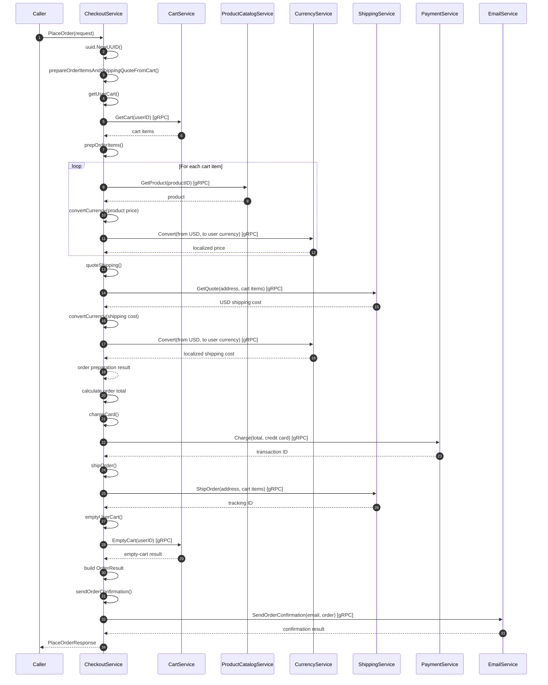

# Checkout `PlaceOrder` call flow

The swim lane diagram below follows the calls made by `PlaceOrder` in
[`src/checkoutservice/main.go`](/home/tawdball/workspaces/temporal-boutique-demo/src/checkoutservice/main.go).
Calls between services are labeled **gRPC**.

Original Diagram

